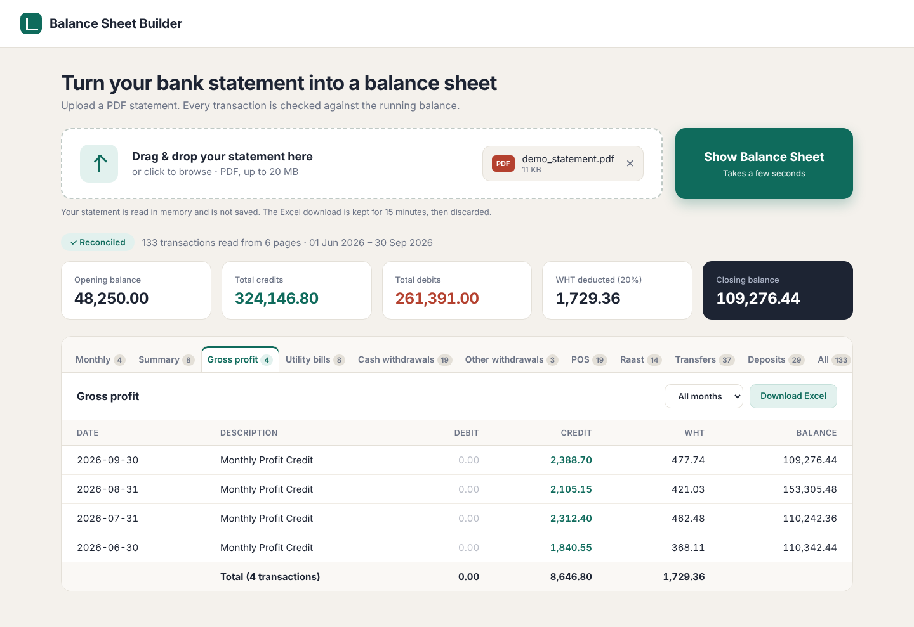

# Bank Statement to Balance Sheet

**Live demo:** https://bank-statement-to-balance-sheet.onrender.com/(free hosting, so the first load can take about a minute). Try it with `sample/demo_statement.pdf`.

Upload a PDF bank statement and get a balance sheet: every transaction extracted, checked against the running balance, grouped into categories, and exported to Excel.



## What it does

- Reads text-based PDF statements with Date / Particulars / Debit / Credit / Balance columns
- Extracts all transactions across every page, including descriptions that wrap onto a second line
- **Checks every row against the running balance**, so a missed or misread row is flagged instead of silently wrong
- Detects withholding tax (20% on profit credits) that the statement does not list as its own line
- Groups transactions into categories, with one tab per category plus Monthly and Summary views
- Exports everything to Excel, with one sheet per tab

## Privacy

The uploaded PDF is read in memory and **never written to disk**. The generated Excel file is kept in memory for 15 minutes so it can be downloaded, then discarded.

## Try it

A fictional demo statement and the Excel file produced from it are in [`sample/`](sample/). All names, amounts and balances in them are invented.

```bash
python -m venv .venv
.venv\Scripts\activate          # Windows (Mac/Linux: source .venv/bin/activate)
pip install -r requirements.txt
uvicorn balance_app:app --reload
```

Open http://127.0.0.1:8000 and upload `sample/demo_statement.pdf`.

## Limitations

- Works with text-based PDFs only. Scanned (image) statements are not supported.
- The parser is built for one statement layout. Other layouts need parser changes.
- No login or user accounts. Run it locally, or add authentication and HTTPS before putting it online.

## Built with

Python, FastAPI, pdfplumber, openpyxl. Categories and the tax rate can be changed at the top of `balance_app.py`.

